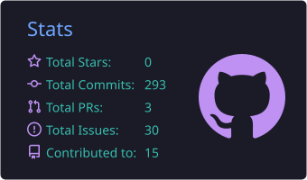
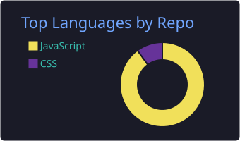

<!-- Replace VVF2245 with your GitHub username everywhere -->

  

  
  

### 👨‍💻 About me

Third-year Software Engineering student at the **University of Seville**. I enjoy building backends with Java and Spring Boot and connecting them to React frontends. I've studied and lived abroad in Germany, Ireland and the UK, and I'm looking for a team where I can learn and contribute in an international environment.

### 🧰 Tech stack

  
  
  
  
  
  
  
  
  
  
  
  
  

### 🚧 What I'm working on

- 🏨 **[Hotel Management System](https://github.com/VVF2245/hotel-management-system)** — room reservations and housekeeping (Spring Boot + React + MySQL). *In progress.*
- 🎲 **Online Board Game** — university team project with 6 people in an agile workflow.

### 🌍 Languages

🇪🇸 Spanish (native) · 🇬🇧 English (C1, Cambridge CAE) · 🇩🇪 German (B1)

### 📊 GitHub stats

   

### 📫 Contact 

